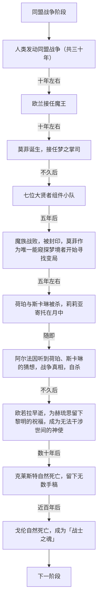
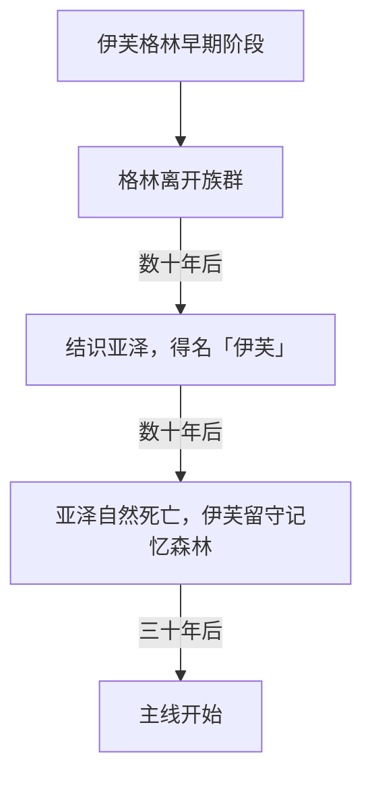
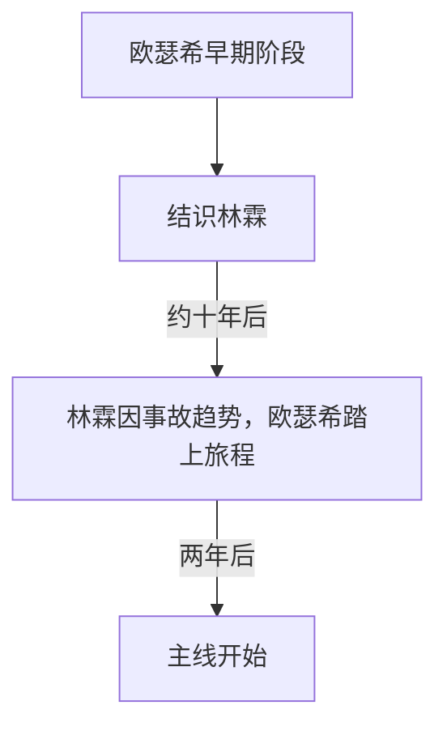
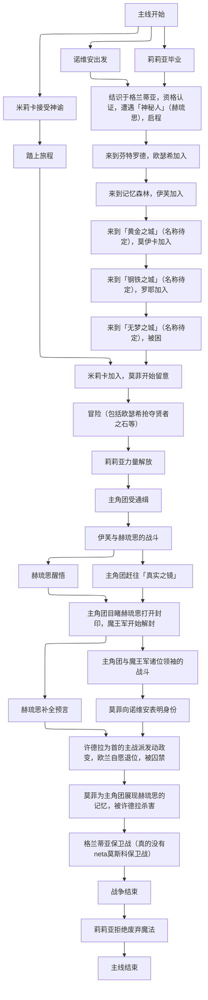

# 大纲草稿

## 设定概览

### 魔力学概念设定

1. 魔力：魔力是生命活动与自然运动的表现，是能量的一种形式，用于驱动魔法。魔力可容纳于生命或特定材料制作的容器。

2. 魔法：以魔力为能源进行能量转化的功能性技术。主要流程为引导魔力流动、能量转化、进行时控制。这一流程中可用工具辅助，如法杖、魔导书等。必要时还需构建魔法阵、祭坛等作为魔力流动的引导。

3. 原质：天然存在于物质中的一种魔力形式，通过人为引导可转化为可应用于魔法的魔力（类似于势能和动能的关系）。动植物、矿物、自然运动的载体（如流水等）中均含有较多的原质。

4. 魔器：人为制造的、可将魔力转化为其他形式能量的工具或机械、魔法大陆（名称待定）上常见的武器，几乎均是注入魔力以构建魔法或提升性能的魔器。

5. 魔力学三大定律：
   
   1. 魔力学第一定律（魔力·原质统一定律）  
      魔力的流动实质上是改变原质分布的过程。  
      魔力学第一定律揭示了魔法的实质是魔力与原质相互转化的运用——人为将魔力转化为物质中的原质以改变其性质。
   
   2. 魔力学第二定律（魔能守恒定律）  
      在魔力与原质相互转化的过程中，魔力与原质在统一量纲后总和保持不变， 统一地，称为「魔能」。  
      魔力学第二定律揭示了人们所使用的魔力不是凭空产生或消灭的，而是有来源、有去向的。生命体中积累的魔力来源于生命所处的环境；魔力在环境与生命之间的流动是生命活动的一部分。
   
   3. 魔力学第三定律（能量守恒定律在魔力学中的体现）  
      魔能可与其他形式的能量相互转化，且在转化过程中能量总和保持不变。  
      魔力学第三定律揭示了魔法的实质，解释了魔力为什么能为人所用，使魔力运动与其他能量运动统一起来。

### 世界观设定

#### 文明与种族

##### 人类

人类文明的发展可追溯到史前时期。人类形成聚落，建立早期国家，在口耳相传中积累知识。如今，人类领导的国家与城邦已经遍布整个大陆。人类的领导能力，也被精灵与矮人族认可。

人类对魔法的研究已经到了成熟的地步，构建起了完整的理论体系。魔法已然渗透到了人类社会的方方面面，各行各业都有魔法的应用。人类因此被称为「驯服魔力的短生种」。

##### 精灵

精灵是现已知最为古老的种族，被公认为「诞生于山川林隙的长生种」，是一直以来生活在森林之中的种族。

精灵的生命来源于自然，因此拥有很强的身体机能、千岁以上的自然寿命、几乎不会衰老的容貌与较强的再生能力。外貌与人类相近，特征为修长的尖耳。

精灵一族使用的魔法与人类所用的存在很大差异。精灵的力量直接来源于自然，它们可以直接利用自然运动中的原质构建魔法，在历史的很长一段时间超前于人类。

##### 矮人

矮人是在精灵之后诞生的种族，是第一个构建起系统文明的种族，也被称为「大地与传统的长生种」。对于矮人的由来，传说是大地在寒风中孕育了矮人的祖先，之后在大陆的北部生息繁衍。

矮人一族世世代代引用圣水，代代相传的传统造就了矮人坚如磐石的体格。积累下的原质也使矮人一族拥有两百年左右的自然寿命。而且虽然名为「矮人」，实际上身高并不会与人类有显著差异。

矮人一族几乎没有自主形成的魔法体系。对于体内大量原质的应用也仅局限于增强身体机能。不过与人类一直以来的友好交往使得矮人法师也变得常见起来。

值得一提的是，在从人类那里习得了相关知识以后，矮人一族还以魔器锻造的种族天赋出名。

##### 哥布林

哥布林也是较为原始的种族，具有人性，四肢较长，皮肤介于灰绿色至土黄色，有类似于精灵的尖耳朵，大部分具有绿宝石色的眼睛，寿命与人类相近。

从历史出现的年代起，哥布林就长于与其他种族进行贸易。种族所特有的经济头脑使得其与除精灵外的几乎所有种族都建立过友好关系。某些实则并不存在的刻板印象与「泥土与精灵催生的短生种」的称号可能也由此而来。

哥布林一族之间都是不同种族之间贸易的桥梁，其中立的态度也深受交易双方的信赖。

由于与各种族都有过交流，哥布林一族虽然几乎没有属于自己的魔法体系，但凭借强大的学习能力，除精灵外的各个种族的魔法都有所涉猎。

##### 魔物

魔物实质上是经过长期接触高浓度原质而从野生动植物种群进化而来的物种。其中，由野生动物进化而来的魔物特称为「魔兽」。

魔物与正常动植物的区别在于具备引导原质与魔力相互转化即使用简单魔法的能力。

##### 魔种

相传魔种是由神明创造世界时的错误产物，而其何时诞生缺乏史料。目前最为可靠的记录是在人类诞生前魔种就已经存在。

大部分的魔种在外观上与人类相似，但拥有魔物的特征，寿命较人类长，约百岁左右，但仍属于短生种的范畴。

魔种曾被称为「魔族」，在历史上很长一段时间与其他种族友好相处，但饱受精灵一族的偏见，虽然两个种族之间并无仇恨。

在五百年前，经过长达三十年之久的同盟战争，魔族最终战败于七位大贤者所领导的同盟军，被尽数封印至今。

魔种与人类发展早期魔法的进程几乎是一致的，但魔种的魔法一直因拥有潜在的副作用被列为禁忌。

#### 社会组织及团体

##### 骑士团同盟（名称待定）

简称「同盟」。是于同盟战争爆发后，人类、精灵、矮人共同建立的反抗魔种的同盟，并延续至今，成为整个大陆规模最大的政权。

同盟由近一百个王国、城邦以及无数村落组成，有人迹的地方就是同盟的领地。

同盟的领导机关是由人类、矮人与精灵共同组成的联协会，由三组代表共同行使权力。

##### 魔王军

魔王军是以同盟军相对立的军队统称，因受魔种领袖魔王欧兰领导而得名，下设七个军团。

在五百年前的同盟战争中，魔王军被七位大贤者尽数封印。

##### 格兰蒂亚魔法学会

简称「格兰蒂亚学会」。是由七位大贤者在同盟战争胜利后，建立的系统性研究魔法理论与应用的组织，代表现代魔法研究的权威，学会成员大多为资深的人类魔法师。不过可能是魔法体系存在较大差异的缘故，精灵从未参与过学会的研究。

学会下设「格兰蒂亚魔法学院」，是同盟中最大的魔法教育机构，每年会定期举办魔法资格认证，以认定魔法使、炼金术师、神官、魔具使等魔法从事者使用魔法的能力。

因此，格兰蒂亚学会已成为魔法学术界举足轻重的学术组织，在划定与肃清禁忌中起着不可或缺的作用。学会总部与学院的所在地「格兰蒂亚」也被称为「魔法之城」。

##### 伊莲教会

在早期社会诞生之际，播撒智慧与爱的女神伊莲就已被诸多生灵所信仰。人类通过与女神交流，获得了庇护与指引，并学习了施以祝福的方法。女神的信徒们经过长时间的努力，建立了统一的教会。

同盟战争时期，伊莲教会的神官在战场上救死扶伤，并使用从女神那里习得的魔法辅助同盟军战斗，为同盟取得胜利做出了巨大贡献。

#### 魔法史

自生命诞生起，魔法的发展就从未止步，实际上已经成为了区分文明与野蛮的标志。据考证，魔法应用的源头，或许是原始生命对魔力运动规律的一次次探索。

魔法发展至今，可粗略地划分为三个发展体系：

##### 精灵族魔法

作为最古老的种族，精灵可以称得上是最早开始发展魔法的。但精灵族对魔法的发展，并非有意的探索行为，而是身为山川与森林孕育出的生命的一种本能。他们本身与魔力和原质共呼吸，操纵魔力的流动似乎是与生俱来的才能。

也正因如此，没有人能揭露精灵族魔法的详细作用原理。这就像探究高山与流水为什么会是人们所见的形状、鸟为什么会飞一类的问题——由于在自然演替中涉及太多的因素，以至于无法找到明确的答案。唯一能归纳出的规律，是精灵一族的力量来自于自然运动。他们可以直接使用蕴藏在自然环境中的大量原质构建魔法，或是将原质以极高的效率转化为魔力，而不需使用自身体内的原质和魔力。

##### 神代魔法

神代魔法是信奉女神伊莲的信徒在于女神的交流中习得的魔法。神官在祈祷与探寻中得到女神的指引，进而积累下魔法体系。

神代魔法被认为是女神伊莲使用的魔法，是神明时代由神明创造的魔法的一部分，其发展程度超出了目前已知原理的任何魔法。神官在使用神代魔法的过程中，实际上并不理解其过程与原理，因此只能在与女神伊莲的交流中发动。

##### 现代魔法

现代魔法起源于原始人类与魔种对魔力流动的探索。在历史的很长一段时间中，早期的人类与魔种魔法师更像是传递经验一般以口耳相传的方式积累民间知识。大陆上出现了众多自行总结经验的大魔法使，各自提出了不同的理论，在思想碰撞中逐渐摸索出现代魔法理论的雏形。

在前人探索的基础上，大魔法使傅泽提出了「原质」的概念。傅泽的学生，大贤者「斯卡琳」在傅泽工作的基础上归纳出「傅泽-斯卡琳三定律」（即魔力学三大定律），宣告了魔力学的建立，标志着现代魔法理论的诞生。

现代魔法是目前唯一一种完全掌握作用原理的魔法体系。这意味着它可以被系统性地学习、教授与发展。人类所使用的魔法，几乎全都属于现代魔法的范畴。在现代魔法理论建立后的五百年的时间里，魔法的各大领域，如魔力学、应用魔法学、炼金学、魔器学、占星学等都有了显著的进步。

> 经过长时间的研究和实验，大贤者斯卡琳已经证明，以上三种魔法在本质上是统一的，都是通过魔力流动改变原质的分布从而产生魔法效应。

## 剧情相关

### 背景梗概

很久以前，魔法大陆上诞生了不同种族创建的文明，人类、精灵、矮人、哥布林、魔族等种族，有很长一段时期彼此共处。

至今五百年前，魔族发动了对人类的战争。人类团结起精灵、矮人的力量，建立起骑士团同盟，与魔王军对峙。三十年过去了，双方僵持不下，唯有仇恨不断积累。

结束战争的是一支年轻的勇者小队。人类的骑士、魔法使、炼金术师、神官与游侠，精灵的弓箭手与矮人的战士带领同盟军赢得了这场战争的胜利。他们用七个人的魔法将魔王军尽数封印，为同盟带来了和平。作为胜利的关键，他们被同盟尊称为七位大贤者，在史书上留下了自己的名字。这场战争，被后世称为“同盟战争”。

战后，在小队的队长，大贤者荷珀的提议下，七位大贤者得以过上普通人的生活。随着时光流转，作为人类的五人纷纷走到生命的尽头，矮人战士戈伦也在两百年后衰老死亡。唯一的精灵弓箭手，大贤者赫琉思或许仍在森林中过着平静的生活吧。

生前，小队中的神官，大贤者欧若拉留下了预言。这场战争会带来五百年的和平。在那之后，将会出现新的勇者小队定义未来。

如今，五百年的时光已逝，封印依然屹立不倒，大陆仍然处于和平时代，焕发着魔法的生机。

### 真相

五百年前的人类联邦因为觊觎魔族的土地，制造事端并嫁祸于魔族，然后以自卫反击的名义发动对魔族的侵略。这使得本无开战意愿的魔族也不得不出兵防御。为了集结力量，人类提议建立同盟。不明真相的精灵族与矮人族选择站在人类一方，同盟建立。同盟军与魔王军长时间地对峙，仇恨愈发尖锐。

在三十余年的战争年代中，同盟的人民始终以为是魔种挑起了战争、发动了侵略，整个同盟社会都弥漫着仇恨。七位大贤者就生于这样的社会背景下，最终直至战争胜利都没有意识到自己成为了正义名义下侵略的工具。

战后，为增加正当性，同盟将魔种所使用的魔法划为禁忌。而小队中的魔法使斯卡琳经研究，证明了魔种的魔法与人类的并无区别，都属于现代魔法的一部分，更没有什么副作用。可这并没有阻止同盟的行为。

为彻底消除后患，同盟高层选择了秘密杀害斯卡琳以及一直在研究高级魔法的家族。在斯卡琳分娩的夜晚，同盟军发起了突袭。荷珀这才明白人类联邦的说辞只是借口，最终战死在房前。斯卡琳在生下孩子后，目睹了荷珀的死，在愤怒中升起了红月，为寄托孩子的灵魂争取时间。最终成功地让孩子的灵魂沉睡在月色中，等到这场关于「禁忌」的封锁结束以后再唤醒。而她本人却因魔力耗尽死去。

其他五位大贤者见红月升起，赶往荷珀与斯卡琳的住处，但均没有抵抗得了红月的侵蚀，在半途就失去了意识。醒来后仅得知「斯卡琳在钻研禁术中失控，而使丈夫、孩子以及前来护卫的军队失去了生命」。失去了团队的核心，剩下五人在和平年代无不再有所作为。神官欧若拉潜心寻找女神伊莲的救赎，将预言托付给弓箭手赫琉思以后便英年早逝，灵魂成为了神使。而作为唯一能见到五百年后的世界的精灵，赫琉思在荷珀死后无法找到希望，不知所踪。矮人戈伦选择坚守在封印旁直至死亡。游侠阿尔法执着于正义，曾听到了荷珀与斯卡琳关于战争正义性的讨论，在两人死后，在禁卫军的任务中对正义与和平的选择感到迷茫，最终自杀。炼金术师克莱斯特执着于研究贤者之石，渴望找到再见到四通朋友们的方法，但穷尽一生也未完成。

如今，唯有赫琉思知晓欧若拉留下的预言的全貌——当战争再次到来时，红月将再度升起，只有真正的预言之子们，才能带来新的和平。

### 人物简介

#### 诺维安（Novian）

性别：男

种族：人类

职阶：魔具使·剑术师/骑士

描述：本作主人公。出身于小镇的少年。因自幼受大贤者们的冒险故事的影响，前往魔法之城格兰蒂亚，结识同伴并组件冒险小队，踏上了探索遗落区、追随大贤者足迹的旅程。性格沉稳平易，但也充满少年气。拥有一把据说是由矮人与精灵共同锻造的剑。常常受直觉影响，不由得被引向某个目标。

创作手记：

1. 「诺维安（Novian）」取自拉丁文「Nova」，取「新的」之意。

2. 与之强相关的意象有「路」「歌」等。

#### 莉莉亚（Lilia）

性别：女

种族：人类

职阶：魔法使

描述：本作女主角。被格兰蒂亚的居民们抚养长大的孤儿。就读于格兰蒂亚魔法学院的学院派魔法使。因在神秘人的袭击中被诺维安所救，从而与诺维安一同踏上旅程，寻找贤者之石。性格认真要强，有些天然呆与倔强，常被戏称为「书呆子」。精通魔力学理论与应用魔法，但她的魔力在被神秘人袭击后受到抑制。

创作手记：

1. 「莉莉亚（Lilia）」为拉丁文中「百合」的阴体形式。

2. 与之强相关意象有「白色百合」「红色」「月亮」等。

#### 欧瑟希（Ossessy）

性别：男

种族：人类

职阶：炼金术师

描述：年轻的少年律者，最初与主角二人在从格兰蒂亚前往芬特罗德的旅途中相遇后加入小队。性格洒脱随性而又有书卷气，喜欢开玩笑与将荤段子，却又让诺维安感到看不透他的内心。实战经验丰富，常常以关键性作用扭转战场局势。

创作手记：

1. 「欧瑟希（Ossessy）」取自拉丁文「Obssessio」，取「执念」之意。同时，这并未他的本名。

2. 与之强相关的意象有「雨」。

#### 伊芙格林（EverGreen）

性别：女

种族：精灵

职阶：魔法使、魔具使·弓箭手

描述：精灵弓箭手。前精灵王族继承人，因见到莉莉亚胸口精灵魔法的印记而加入小队。知性友善而理智，对人类十分亲近，这使得她在精灵族群中被视作另类。独特的个性使她颇具神秘色彩。精灵族魔法与现代魔法的集大成者，锐利而果断的战斗经验使她常常能打出致命一击。

创作手记：

1. 「伊芙格林（EverGreen）」，即「常青」。

2. 与之强相关的意象有「风」「笛子」等。

#### 莫伊卡（Moika）

性别：女

种族：哥布林

职阶：游侠·盗贼

描述：（施工中）

--- 

# 设计手稿

多为创作时的记录，可能具有剧透性质，经整理汇总如下：

---

## 五百年前的勇者小队

人类取得五百年前那一场同盟战争的胜利，由各领域最优秀的人才组成的勇者小队——即后来的大贤者们——起了决定性作用。他们领导同盟军，战胜了魔王欧兰，为大陆带来了长久的和平。

勇者小队中的七人，均生于同盟与魔族矛盾最尖锐的时期，自小就受到社会潮流的影响，将战胜魔族作为使命，最终成为了侵略的工具。但不可否认地，他们应当被历史所铭记。

「坚如磐石的重锤」——矮人战士戈伦，是生于矮人族群的王子。他代表矮人一族坚毅的力量，为同盟用战锤筑起牢不可破的屏障。

「寂静的裁决天平」——游侠阿尔法，是小队中最为年幼的成员。双亲在战场上罹难的她对正义有着执着的追求，用双手中的短刀斩断一切荆棘。

「呼唤黎明的圣女」——神官欧若拉，是受到女神祝福的圣女。她为众生传达伊莲女神的神谕，用祝福驱散伤痛，用光明驱散黑暗。她留下来的预言，为人类指明了前进的方向。

「长生的太阳之子」——精灵弓箭手赫琉思，是精灵王族最年轻的继承人。与生俱来的天赋使他得以牵动太阳的光辉，化为利箭，同时，身为精灵的他可以完美引导自然的力量，驱逐心中的障碍。

「闪烁的微光之种」——炼金术师克莱斯特，是被称为「百年难遇」的天才炼金术师。在他的手中，有无数的物质得以诞生。在不同原质的相互作用中，他唤来风雨、震动大地，使战场上的形式在一瞬间得以转变。

「绯红的大魔法使」——魔法使斯卡琳，是有着数百年历史的魔法世家的长女。师从大魔法使傅泽的她，因建立了现代魔法体系而被称为魔法时代的起点。她魔杖上绯色的玛瑙，勾勒出圆月的影子。

「守护希望的勇者」——小队的队长，骑士荷珀，是汇集了全人类希望的勇者。他用长剑守护着人民的一切希望，结束了战争，换来了长达五百年的和平。

---

## 贤者之石

「原质精矿」的别称，几乎是一块纯粹的原质。因「闪烁的微光之种」——大贤者克莱斯特发现了其诸多独特性质并开发出多种极其强力的魔法而以「贤者之石」的别称广为人知。

贤者之石极其珍贵，是无数魔法使与炼金术师心目中至高的珍贵材料。因此成为象征魔法的代表物。同时，因其极小的储量，以及「点石成金」的民间传说，它也是无数黑市商人觊觎的宝物，成为欲望与污秽的象征。

剧情中与之关联的情节包括：

- 克莱斯特作为七位大贤者中唯一自然死亡的人类，在后半生一直都在研究贤者之石，但临终前未能完成使同伴复生的魔法。

- 莉莉亚作为最优秀的毕业生，从导师那里得到了一块贤者之石。后落入赫琉思手中。

- 欧瑟希完成了克莱斯特的魔法。在得知主角团在寻找贤者之石时，立即加入了小队。后在石蛇庄园中不顾其他人劝阻夺得了庄园主的贤者之石，以记忆为代价复生了儿时玩伴。  
  （注：「石蛇庄园」同时也是曾经的魔族领袖之一「九头蛇」许德拉以及蛇族庄园的遗址。）

- 格兰蒂亚保卫战中，许德拉用贤者之石发动了大规模魔法，召唤出了神话中的九头蛇。

---

# 非正式文稿

（注：这一部分不是严肃设定集，内容仅供了解参考。）

---

## 角色设计讨论

（注：作者向朋友001MutedMortal写的角色形象设计讨论。）

比起男女主，小队中的其他成员反而最先让我有个印象。这次主要想讨论其中的三位——人类炼金术师、精灵弓箭手伊芙和哥布林游侠莫伊卡。

### 欧瑟希 （Ossessy，取自「执念」Obssessio一词）

男性，人类，主线开始时为17岁。

发色：棕色

瞳色：棕黄

头部标志性特征：单片眼镜

发型：碎盖及耳，后侧留有小辫子

衣着描述：虽然作品中没有涉及与中国相对应的国家，但欧瑟希的确来自中国，「欧瑟希」也只是为了在魔法大陆活动而起的拉丁文名。衣着方面，西式学究风格，上着棕色交领大衣，带有中式盘扣以及边角处的「回」形花纹。下着纠结于长袍与长裤之间。总体上来说是一个有大量中式元素的西式角色，毕竟大舞台是西式幻想。少年元素与学者元素以及一点旅者特征的融合，让我有些摸不着头脑。

个性配饰：腰间的包~~（四次元口袋）~~，用于收纳各种药剂与随身物品。

### 伊芙格林（EverGreen，即「常青」）

女性，精灵，主线开始时约200岁，外貌约20岁。~~知心大姐姐。~~

发色：青绿

瞳色：翠绿

头部标志性特征：精灵共有的长尖耳，头上戴有橄榄枝一般的发饰。

发型：利落的细碎短发。

衣着描述：参考古希腊女性的纯白长袍，但作为常年生活在森林中的精灵，为增加飘逸感，下摆可简短到及膝（清凉一点（迫真）），上身也可大幅改动以现代一点，外有短披风，带有为了隐藏自己精灵身份的兜帽。

个性配饰：由活木制成，注满了原质一直在生长的长弓，两端是自然延伸的枝叶，非战斗状态下会背在身后。以及一把木质长笛，通常会挂在腰间。

### 莫伊卡（Moika）

女性，哥布林，主线开始时为15岁。

发色：亚麻色

瞳色：金黄

肤色：偏向灰色

头部标志性特征：哥布林共有的尖耳。小虎牙。

发型：刘海，细长的双低马尾（~~类似于《辉夜大小姐想让我告白》中的伊井野弥子但更长（？）~~）

衣着：罗宾汉式的游侠装束，土黄色兜帽与披风，墨绿色长围巾，会垂在身后。下着则使深色的短裤与短靴。防滑用的露指手套。

个性配饰：装有各种武器的挎包，腰间挂有父亲送给她的带鞘短刀。

---

## 如何在十分钟内了解《长歌》主要内容（节选）

（注：原文具有整活性质，部分内容与该文稿内容重复，只选取了有价值的部分）

该概略由以下若干部分构成：世界观、人物、主要情节。

### 世界观方面

《长歌》设定在一个由神创造、魔法背景的世界，主要故事均发生在「魔法大陆」（名称待定）上。

「神」的要素基本上不直接体现在作品中。有名有姓的「神」只有女神伊莲。

「魔法大陆」中有思想的物种（统称为「生灵」）包括：精灵、矮人、哥布林、魔族、人类等。 特别需要指出的是：「魔族」与「人类」均是神为了让世界更富生机的产物，只不过后者更脆弱也因此更进取。 

为了争夺土地与魔法理论的主导权，人类发起了对魔族的侵略战争，并且制造事端，声称是魔族发起的战争。精灵与矮人不知实情，与人类建立同盟，夺得了战争胜利，史称「同盟战争」。

同盟战争后，魔族被七位大贤者的魔法封印。直至五百年后，封印被打开，魔族发起了夺回土地的战争。 

（注：两次战争并没有对「二战」的影射。） 

### 人物方面

主要人物可划分为三个七人组（括号内为非官方代称或昵称）：

七位大贤者：可理解可理解为前一代主角团。是同盟战争期间由同盟各领域最杰出的人才组成的勇者小队， 带领同盟军取得胜利，为后世所传颂。 

- 荷珀：队长，人类骑士。纯粹的天赋与数值。

- 斯卡琳（红妈）：人类魔法使。瑟伦（取自月神）家族长女。现代魔法理论的起点。

- 克莱斯特：人类炼金术士。贤者之石研究的集大成者。晶体原质研究之父。 

- 赫琉思（牢赫）：精灵弓箭手。精灵王族继承人。被太阳神选中的太阳之子。主线开始时唯一存活的大贤者。 

- 阿尔法：人类游侠。皇家禁卫军代表。最年轻的成员（战争胜利时只有17岁）。双亲在战场上罹难。

- 戈伦：矮人近卫。

- 欧若拉：人类神官。被称为「圣女」的大主教。去世后成为神使，在主线中发挥重要作用。

七位魔王军领袖：同盟的主要敌人。实质上除库拉里以外均是为守护子民而战。

- 欧兰（龙妈）：现任魔王。龙族的代表。纯粹的数值怪。魔骑士。

- 许德拉（蛇叔）：九头蛇。蛇族的代表。与欧兰关系很好，是师姐弟关系。最强打工人。炼金术师。

- 希普诺斯：幻术师。个性鲜明的「三当家」。执着于战争的意义。特效姐。

- 「镜之恶魔」：名字未定。极度嘴贫的打工人。欧兰之下最强近战。

- 库拉里：精灵弓箭手。原精灵族继承人，因挚爱被杀又得知了战争真相而加入魔王军， 领导叛军。

- 莫菲：第四百九十五任梦之掌司。巢族的代表，本身属于织梦者一族（即蜘蛛）。贯穿主线的重要人物。

- 「影」（傻豆）：首席刺客，最年轻的领袖。

七位新的勇者：真正意义上的主角团，主线围绕他们展开。 

- 诺维安（男主、挪丸）：本作主人公。真正意义上的冒险者，因大贤者们的故事踏上旅途。

- 莉莉亚（女主、小白）：本作第二主人公。学院派魔法师，为寻找真理踏上旅途。实际上是斯卡琳与荷珀的女儿，瑟伦家族后裔。

- 欧瑟希：东方风炼金术士。为寻找贤者之石复活童年玩伴踏上旅途。

- 伊芙格林：精灵弓箭手。原精灵王族继系人。为延续爱人亚泽的脚步踏上旅途。

- 莫伊卡（喵卡）：哥布林游侠。为探索世界踏上旅途。 

- 罗耶：矮人近卫。为向族人证明自己踏上旅途。

- 米莉卡：人类神官。为理解伊莲女神（实际上是欧若拉）的神谕踏上旅途。

### 剧情方面

主线前：

主线：

